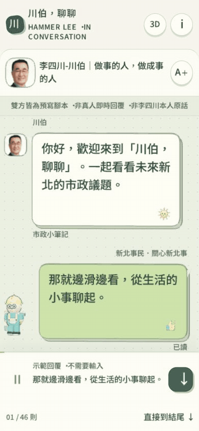
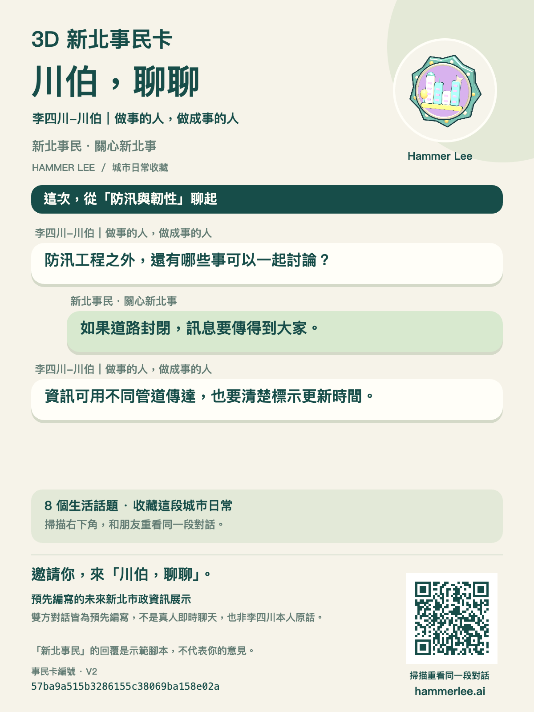

<p align="center">
  <a href="https://hammerlee.ai"></a>
</p>

<p align="center">
  <strong>不用打字，往下滑就開始。</strong><br>
  以 Three.js 做成的立體城市日常：預寫對話、可愛小工班、事民卡與 AR 徽章。
</p>

<p align="center">
  <a href="https://hammerlee.ai"><strong>開啟體驗 ↗</strong></a> ·
  <a href="#看看它怎麼動">看看它怎麼動</a> ·
  <a href="docs/DEVELOPMENT.md">開發文件</a> ·
  <a href="LICENSE">MIT 程式碼授權</a>
</p>

> 這是預先編寫的市政資訊互動展示。雙方台詞都是示範腳本，非李四川本人即時回覆或原話；「你」的回覆不代表訪客意見，內容也不是政見承諾。本專案並非 LINE 產品，亦不代表 LINE 的認可。

## 從一聲你好，到一枚小小的城市徽章

熟悉的對話介面，換上一點立體的想像。往下滑，訊息會一則一則出現；停下來可以慢慢看，也可以直接到結尾收藏這段旅程。

| 滑動，就能聊 | 看得見的立體感 | 把這段日常帶走 |
| :--- | :--- | :--- |
| 不需輸入文字；可快速捲動、回看與跳到結尾。 | 主要對話文字、氣泡、表情、貼圖與小工班都是 3D 幾何。 | 同一組編號可重播同一段腳本，並產生對應徽章、事民卡與分享連結。 |
| 大字、大按鈕；另有純文字閱讀和減少動畫模式。 | 通知音、震動與手機傾斜由使用者選擇開啟。 | 自拍可跳過；支援的 iPhone／iPad Safari 可用 Apple Quick Look 看 AR 徽章。 |

[](https://hammerlee.ai)

## 看看它怎麼動

<table>
  <tr>
    <td align="center" width="50%"><strong>滑動對話 · 側看厚度</strong><br><br><br><a href="docs/media/mobile.png">查看靜態畫面</a></td>
    <td align="center" width="50%"><strong>收藏一張新北事民卡</strong><br><br><a href="docs/media/citizen-card.png"></a><br>自拍是選項；不拍照，也能製卡。</td>
  </tr>
</table>

*上方 GIF 為網站操作節錄；圖卡為實際匯出。AR 空間擺放需支援的實體裝置，這裡沒有以示意動畫冒充實機 AR。*

## 用心對待每一次閱讀

- **在地、好讀。** 使用臺灣繁體中文，從交通、照護、步行等日常議題出發，尊重不同經驗與立場。
- **展示與事實分清楚。** 台詞明確標示為預寫腳本；照片保留來源，第一方宣傳資料不當作獨立查證的成果。
- **選擇留給使用者。** 自拍與 USDZ 在裝置上處理；自拍不會上傳。雲端保存腳本版本與隨機編號，不保存自由輸入的對話。
- **統計說清楚。** 正式站使用 GA4 做一般使用統計，可能使用 Cookie；自訂事件不傳送自拍、對話文字或體驗編號，並尊重 DNT／GPC。詳見[資料處理說明](docs/DEVELOPMENT.md#google-analytics)。

## 一起把它做得更好

想修正文字、改善操作或回報裝置問題，歡迎提出 [Issue](https://github.com/dAAAb/hammerlee-ai/issues) 或 Pull Request。貢獻前請看[參與方式](CONTRIBUTING.md)；安全弱點請使用[私密回報](SECURITY.md)，不要公開貼出憑證或個人資料。

```sh
npm ci
npm run dev
```

完整建置、測試、字型與部署設定收在[開發文件](docs/DEVELOPMENT.md)。目前的實機限制與檢查範圍列於[公開檢查紀錄](docs/REVIEW.md)。

## 授權與致謝

程式碼採 **[MIT](LICENSE)**。第三方套件、Noto 字形資料各自保留原授權；照片、人物肖像與品牌素材不包含在程式碼的 MIT 授權中，另行使用請確認權利。[素材來源與範圍](docs/ASSETS.md) · [第三方授權聲明](docs/THIRD_PARTY_NOTICES.md)

感謝 [Three.js](https://threejs.org/)、[Noto CJK](https://github.com/notofonts/noto-cjk) 及本專案使用的開源元件。視覺方向參考 [April Zhu — Color Figures](https://april-zhu.com/colorfigures)；市政議題與照片來源紀錄見 [research](research/)。互動與幾何生成由本專案實作，參考與第三方素材分別標示。
